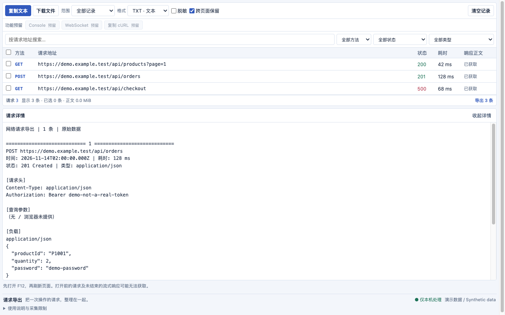

<div align="center">

<h1>Network Request Exporter</h1>
<p><strong>One workflow. Its requests. One export.</strong></p>
<p>Batch-copy request headers, payloads and response bodies from Chrome DevTools.</p>
<p><a href="README.md">简体中文</a> · <a href="PRIVACY.md">Privacy</a> · <a href="CONTRIBUTING.md">Contributing</a></p>
<p>Chrome / Edge · Manifest V3 · MIT · No runtime dependencies · Local processing</p>
</div>



A single workflow can trigger several API calls. Collecting each URL, header, payload and response separately is tedious and can lose context. This extension adds a compact DevTools panel to export those requests together as readable text, JSON or HAR.

The interface is currently in Simplified Chinese. The extension is available through source/local installation; it is **not yet listed on the Chrome Web Store**. All screenshots use synthetic demo data.

## Features

- Export request URL, method, query parameters, headers, payload, response headers, status, body and timing.
- Export all records, the filtered results, or selected requests. Repeated calls are retained separately.
- Copy readable text or download TXT, JSON and HAR.
- Filter by URL, method, status class and API type.
- Optionally redact common credential fields without modifying captured originals.
- Keep collecting when another DevTools panel is selected; optionally preserve records across navigation.
- No account, backend, telemetry, traffic upload or request replay.

Chrome already exports HAR natively. This project focuses on readable batch text, selected-request extraction and explicit response-body availability states.

## Install

No build or dependency installation is needed to run the extension.

1. Download and extract this repository, or clone it.
2. Open `chrome://extensions` (Edge: `edge://extensions`).
3. Enable **Developer mode** and choose **Load unpacked**. Select the folder directly containing `manifest.json`: **`extension/` for the source archive**, or **`network-request-exporter/` for the packaged local-install ZIP**.
4. Open a normal web page and press F12 (macOS: `⌘⌥I`). Select **请求导出**, possibly under the `»` overflow menu.
5. Keep DevTools open, reload or perform the workflow, then copy or download the requests.

After installation or an update, close and reopen any existing DevTools windows. Save needed records before updating.

Chrome has been tested with the installed extension. Edge uses the same Chromium extension APIs but has not been tested directly.

## Privacy and limitations

Only `clipboardWrite` is requested, for a user-initiated copy. Captured network data is processed in DevTools memory and released when DevTools closes; downloaded files and clipboard contents remain under your control. See the [privacy policy](PRIVACY.md).

Redaction is optional and off by default. It handles common credentials in headers, URLs, cookies, JSON and form fields. Encoded bodies, unparseable JSON and raw multipart bodies are omitted in redacted exports. Free text, HTML and custom field names may still contain secrets: inspect exports before sharing them or submitting them to AI services.

Requests made before DevTools opened, unavailable browser fields and evicted response bodies cannot be recovered. The extension keeps at most 2,000 records, 2 MiB per response body and 32 MiB of total response text. Missing, timed-out or truncated bodies are labeled. Request headers and payloads are outside the response-text budget.

Console history, WebSocket frames and unfinished SSE streams are not supported. Console, WebSocket and cURL buttons are disabled placeholders, not implemented features. The interface is independent of the native Network panel's filtering and selection.

## Develop

Node.js 20+ for core tests and Python 3 for packaging; no npm dependencies are required.

```sh
npm test
npm run package
npm run test:store
python3 tests/fixture-server.py
```

The fixture page at `http://127.0.0.1:8765` produces synthetic GET / POST / 500 requests. See [development notes](docs/DEVELOPMENT.md), [validation](VALIDATION.md), [publishing](store/PUBLISHING.md) and [contribution guidelines](CONTRIBUTING.md).

## Contribute

Bug reports with browser versions and synthetic reproductions are welcome. Never attach real credentials, private responses or raw production HAR files. See [SECURITY.md](SECURITY.md) for security reports.

If this saves you a few rounds of copying requests, a **Star** helps other developers discover it.

## License

[MIT](LICENSE) © 2026 Network Request Exporter contributors
