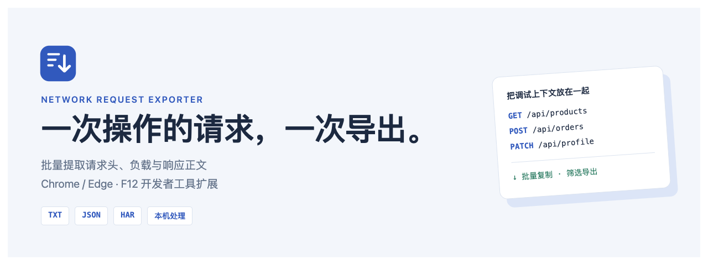
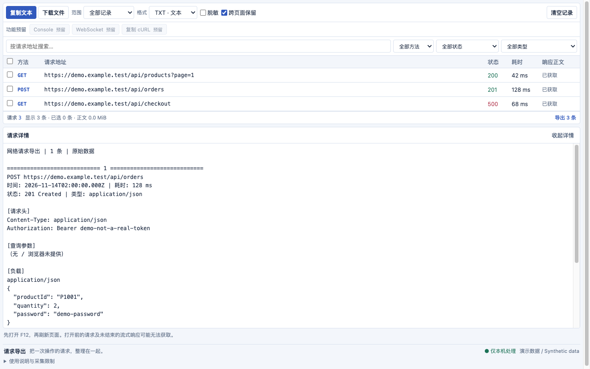
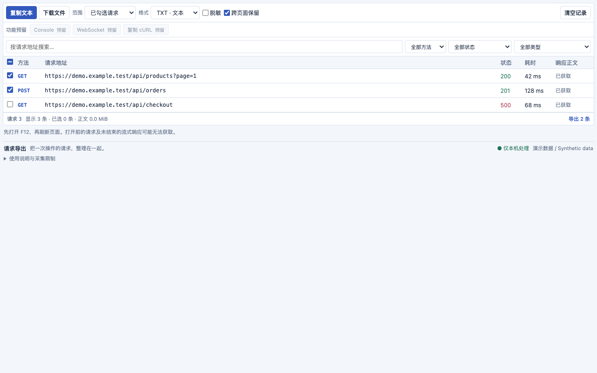
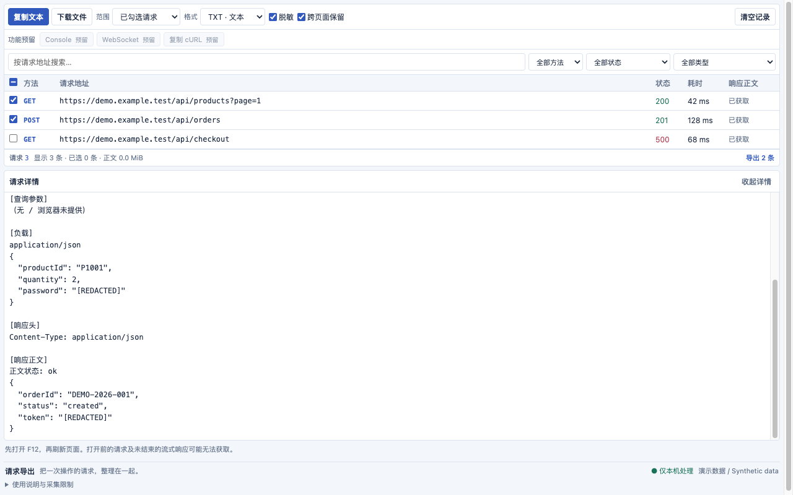

<div align="center">
  
  <h1>请求导出 · Network Request Exporter</h1>
  <p><strong>一次操作的请求，一次导出。</strong></p>
  <p>在 F12 中，把请求头、负载和响应正文整理成可以直接分享的调试上下文。</p>
  <p><a href="README.en.md">English</a> · <a href="#快速开始">快速开始</a> · <a href="PRIVACY.md">隐私政策</a> · <a href="CONTRIBUTING.md">参与贡献</a></p>
  <p>Chrome / Edge · Manifest V3 · MIT · 无运行依赖 · 本机处理</p>
</div>



排查一个业务操作，往往要看多个接口。把每个请求的 URL、Headers、Payload、Response 分别复制出来，很容易漏掉上下文。

**请求导出**在开发者工具中增加一个紧凑面板：操作一次业务，选好请求，一次复制或下载。适合接口联调、缺陷复现、整理测试记录，以及给同事或 AI 工具提供调试材料。

> 当前提供源码和本地安装包，尚未发布到 Chrome 网上应用店。截图中的内容全部为合成演示数据。

## 看看实际效果



## 能做什么

- **一次提取完整上下文**：URL、HTTP 方法、查询参数、请求头、负载、响应状态、响应头、响应正文和耗时。
- **三种导出范围**：全部记录、当前筛选结果、已勾选请求；同一接口重复调用按次数保留。
- **三种文件格式**：TXT 方便阅读和粘贴，JSON 方便程序处理，HAR 方便导入支持它的调试工具。
- **一键复制文本**：复制失败时提供手动复制弹窗；也可下载文件。
- **快速筛选**：请求地址、方法、状态类别、Fetch / XHR / JSON 接口类型。
- **可选脱敏**：处理常见凭证、Cookie、JSON 与表单字段，导出副本不会修改原始采集记录。
- **紧凑界面**：常用按钮位于顶部，支持窄面板；切换到其他 F12 标签后继续采集。
- **本机处理**：没有账号、后端、遥测或请求上传，也不会重新发送业务请求。

Chrome 原生 Network 已支持 HAR 导出。本项目侧重**适合阅读的批量文本、勾选提取和带正文状态的结构化输出**，方便把一次操作的请求放在一起。

## 快速开始

**插件本身不需要 Node.js、Python、npm install 或构建。**

1. 下载本仓库源码 ZIP 并解压，或克隆到本地。
2. Chrome 打开 `chrome://extensions`；Edge 打开 `edge://extensions`。
3. 开启「开发者模式」→「加载已解压的扩展程序」→选择**直接包含 `manifest.json` 的文件夹**：源码包选择 `extension`；本地安装版 ZIP 选择解压后的 `network-request-exporter`。
4. 打开普通业务网页，按 F12；Mac 可按 `⌘⌥I`，找到「请求导出」，空间不足时在 `»` 菜单内查找。
5. **先打开 F12，再刷新网页或执行一次业务操作**。
6. 选择导出范围，点击「复制文本」或选择 TXT / JSON / HAR 后「下载文件」。

首次安装或更新时，已经打开的 F12 需要关闭并重开。更新前请先导出需要保存的记录。

Chrome 已做真实安装和网络采集测试；Edge 按相同 Chromium 接口设计，尚未实测。

<details>
<summary>使用打包文件安装</summary>

运行 `npm run package` 会生成以下文件：

- `dist/network-request-exporter-1.0.2.zip`：本地安装版，解压后选择 `network-request-exporter` 文件夹。
- `dist/network-request-exporter-1.0.2-store.zip`：商店上传版，`manifest.json` 位于 ZIP 根目录。
- `dist/network-request-exporter-1.0.2-source.zip`：开源源码版，解压后可直接作为独立 GitHub 仓库的内容。

本地安装版仅用于安装，开发和复跑测试请使用源码版。仓库不提交生成的 `dist/`；首次使用直接加载 `extension` 即可，不必自行打包。维护者发布 GitHub Release 时可附上上述文件。

</details>

## 选好范围，再导出



- **全部记录**：导出本插件保存的全部请求，不受筛选条件影响。
- **当前筛选结果**：只导出匹配筛选条件的请求。
- **已勾选请求**：只导出勾选项，包含被当前筛选暂时隐藏的勾选项。

「复制文本」始终生成可读文本；「格式」只控制下载文件的格式。点击请求地址可查看详情。「清空记录」只清除本插件记录，不影响原生 Network 或业务页面。

## 分享前，可开启脱敏



默认关闭脱敏，以保留调试所需的原始字段。开启后，处理常见 Authorization、Cookie、Set-Cookie、token、password、api_key 等字段，以及 URL 查询参数、HAR cookies、可解析 JSON 和表单数据。编码正文、无法解析的 JSON、multipart 原始正文会省略，可用表单字段仍会导出。

脱敏不保证覆盖自由文本、HTML 或自定义字段中的所有秘密。**分享给他人或 AI 工具前，请检查输出；提交 Issue 时不要附上真实凭证。**

扩展只申请 `clipboardWrite`，用于用户点击后的复制。通过 DevTools 专用接口读取网络记录，不申请 `debugger`、全部网站访问或浏览历史权限。数据在 F12 页面的内存中处理，关闭 F12 后释放；用户下载的文件和剪贴板内容需要自行管理。详见 [隐私政策](PRIVACY.md)。

## 需要知道的边界

- 打开 F12 前的请求可能缺失；浏览器未提供或已回收的正文无法补回。
- 插件有独立的筛选、清空和跨页面保留设置，与原生 Network 面板分开。
- 处理已完成的请求；Console 输入历史、WebSocket 帧、未结束的 SSE 暂不支持。
- 顶部 Console、WebSocket、复制 cURL 按钮只是明确标注的**预留入口**，尚不可用。
- 最多保留最近 2000 条；单条响应正文最多 2 MiB，总响应正文最多 32 MiB。超限、超时或缺失会标记原因。请求头和请求负载不计入正文额度。
- 空字符串只能说明浏览器返回了空串，无法进一步区分合法空响应与浏览器数据缺失。
- 导出范围在点击时固定，不把之后到达的新请求混进本次输出。

更详细的正文状态、HAR 扩展字段和验收方式见 [技术说明](docs/DEVELOPMENT.md)。

## 开发与验证

核心测试需要 Node.js 20+，打包需要 Python 3；都不需要安装 npm 依赖。

```sh
npm test
npm run package
npm run test:store
```

本机演示接口：

```sh
python3 tests/fixture-server.py
```

打开 `http://127.0.0.1:8765`，开启 F12 后点击页面按钮，即可生成本机 GET / POST / 500 请求。更多说明见 [开发文档](docs/DEVELOPMENT.md) 和 [验证记录](VALIDATION.md)。

## 参与这个项目

欢迎报告复现步骤、提出真实使用场景，或提交聚焦的小型 PR。遇到正文缺失或浏览器兼容问题时，提供浏览器版本、正文状态和**合成样例**最有帮助。

- [贡献指南](CONTRIBUTING.md)
- [安全问题反馈](SECURITY.md)
- [更新日志](CHANGELOG.md)
- [上架与 GitHub 发布指南](store/PUBLISHING.md)

后续方向包括 cURL 导出、Console 采集、WebSocket 消息和更多脱敏规则；目前没有完成时间承诺，欢迎先讨论需求。

如果它帮你少复制了几次请求，欢迎点一个 **Star**，让更多开发者找到它。

## License

[MIT](LICENSE) © 2026 Network Request Exporter contributors
